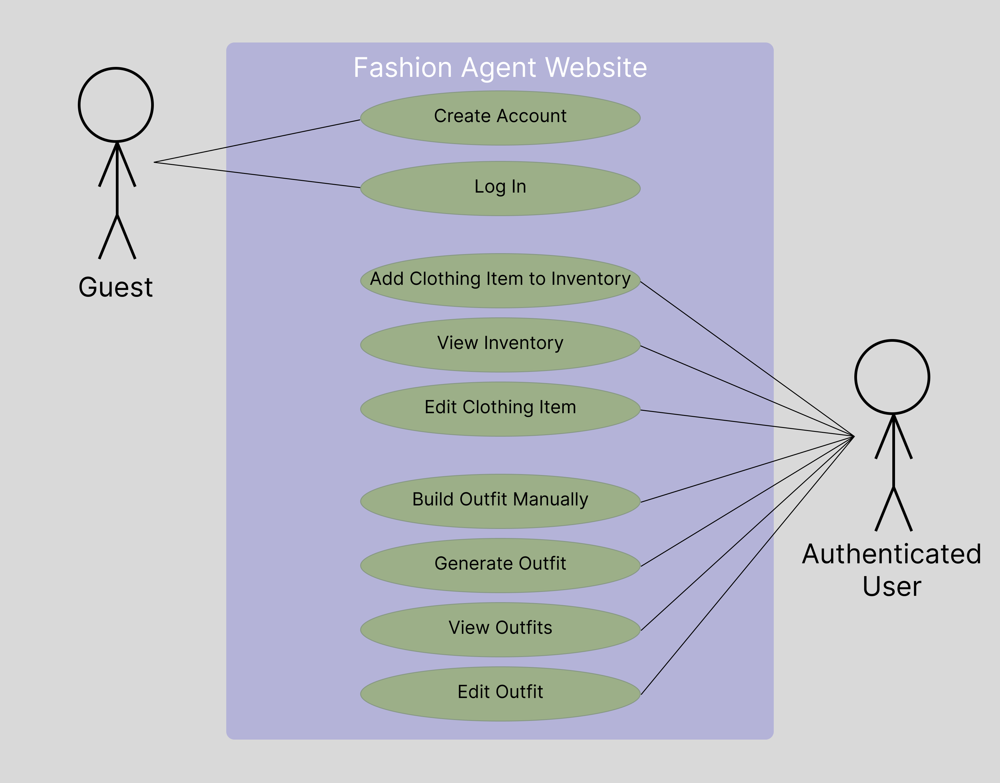
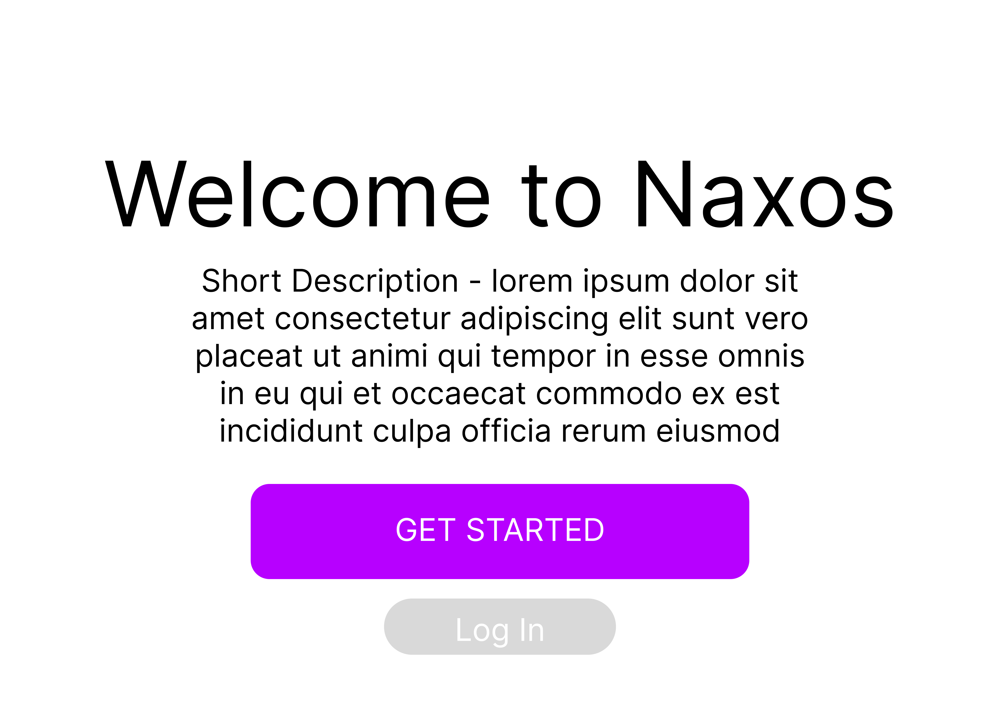
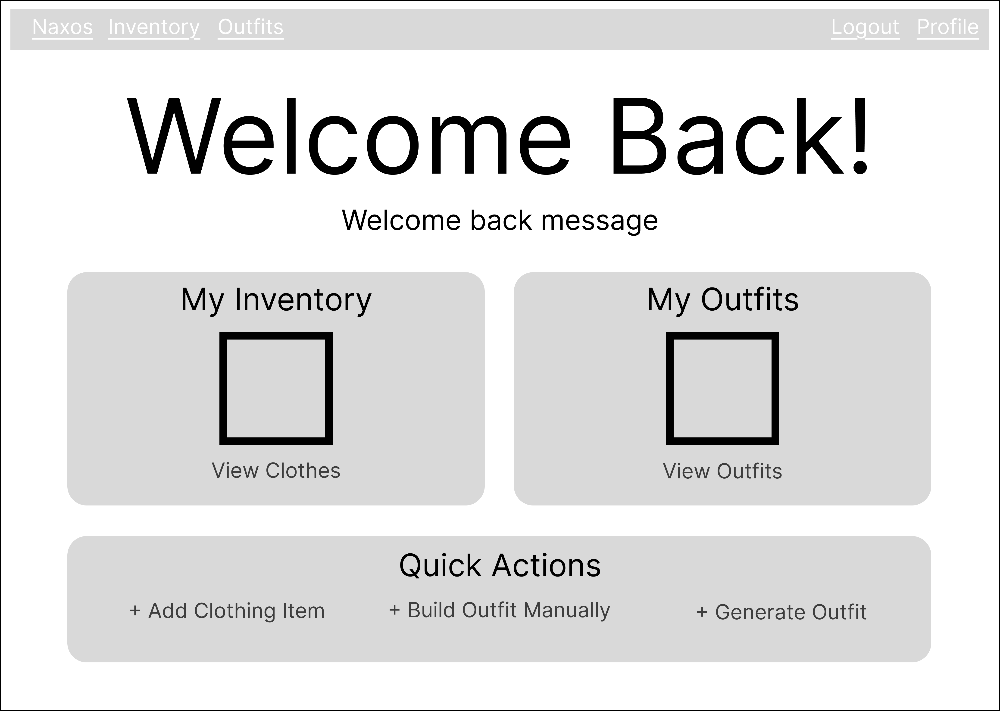
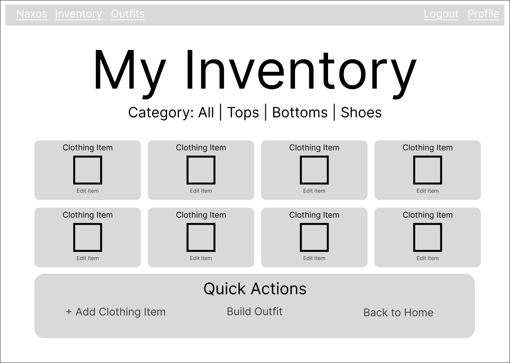
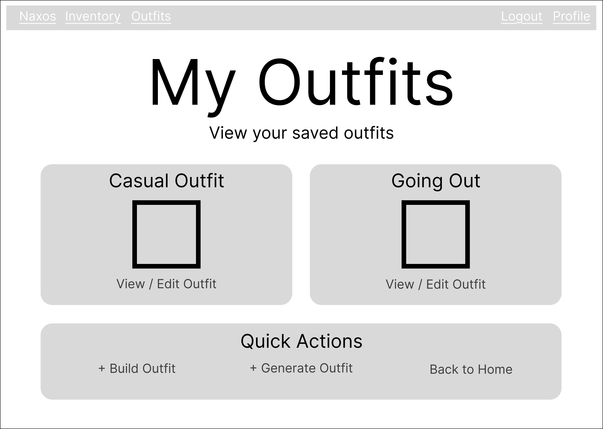

# CSCI 3308 — Lab 8 Project Proposal

> **Project:** Fashion App / Digital Closet  
> **Team Number:** 013-5
> **Lab Instructions:** https://cuboulder-csci3308.pages.dev/docs/labs/lab8  
> **Project Guide:** https://cuboulder-csci3308.pages.dev/docs/project

## 1. Team Number

013-5

## 2. Team Name

Git Dressed 

## 3. Team Members

| Team Member | Email | Username |
| --- | --- | --- |
| Prisha Goyal | prisha.goyal@colorado.edu | PGoyal224 |
| Jaden Cohavi | jaden.cohavi@colorado.edu | Jadencoh |
| Ethan Guirguis | ethan.guirguis@colorado.edu | etexcelebt |
| Sofia Antal | sofia.antal@colorado.edu | soan1217 |
| Aryan Choudhary | arch9012@colorado.edu | AryanFlick |


## 4. Application Name

Naxos

Meaning: 

## 5. Application Description

> **Required:** Write **2–3 paragraphs** describing the application, its functionality, its value to users, and the planned scope. The prompts below are guidance, not finalized commitments.

**Paragraph 1 — Problem and concept:**  
[Describe the difficulty of keeping track of clothing and planning outfits. Explain what the digital closet application does.]

**Paragraph 2 — Core functionality:**  
[Describe the features your team actually agrees to build. Potential examples: add clothing items; categorize and view saved items; build outfits from saved items; edit or delete clothing items; save outfits. Do not promise unapproved features.]

**Paragraph 3 — Value and realistic scope:**  
[Explain how the app will help users, what sets it apart, and which features are in scope for the four-week project. Identify any stretch goals separately if relevant.]

### Proposed Feature Scope (planning aid)

| Feature | MVP or stretch? | Owner | Notes |
| --- | --- | --- | --- |
| [Add clothing item] | [Decide] | [TBD] | [TBD] |
| [View digital closet] | [Decide] | [TBD] | [TBD] |
| [Categorize/filter items] | [Decide] | [TBD] | [TBD] |
| [Edit clothing item] | [Decide] | [TBD] | [TBD] |
| [Delete clothing item] | [Decide] | [TBD] | [TBD] |
| [Create/save outfit] | [Decide] | [TBD] | [TBD] |
| [Other feature] | [Decide] | [TBD] | [TBD] |

## 6. Audience

- **Target audience:** [Who is the app for?]
- **Ideal user characteristics:** [Wardrobe habits, goals, comfort with technology, etc.]
- **User problem:** [What specific frustration does this app solve?]
- **User benefit:** [What becomes easier or more convenient?]
- **Usability:** [How will navigation and workflows remain intuitive?]
- **Accessibility:** [How will the design consider keyboard use, form labels, image descriptions, contrast, and readable text?]

## 7. Vision Statement

> **Required:** A clear, inspirational **1–2 sentence** vision statement.

**Vision:**  
[For **target users** who **have this need**, **application name** is a **digital wardrobe app** that **provides this key benefit**. Unlike **the current alternative**, it **provides this differentiator**.]

## 8. Version Control

- **Public GitHub repository URL:** https://github.com/PGoyal224/Group5-FashionAgent
- **Repository creator:** Prisha Goyal


### Required Repository Structure


```text
<repository-root>/
├── TeamMeetingLogs/
│   └── [Weekly TA meeting minutes — update the same file each week]
├── MilestoneSubmissions/
│   └── Lab_8.md
├── ProjectSourceCode/
│   ├── .gitignore
│   └── [Application source code and relevant documentation]
└── ReadMe.md
```


## 9. Development Methodology


To keep track of the work done over the next 4 weeks, we are using a Kanban Project Board on GitHub. The board can be found under the "Projects" tab in the repository, labeled "Team5-FashionAgentBoard."

## 10. Communication Plan

The team will communicate via Slack for planning and collaboration purposes. Additionally, we will use the GitHub Project Board to mark who is doing which tasks and the status of those tasks. 

## 11. Meeting Plan

### Regular Team Meetings

- **Day(s):** Tuesday, Thursday
- **Time(s):** Indeterminate, depends on schedules
- **Modality:** Group Video Calls

### Weekly TA Meetings

- **Day:** Monday
- **Time:** 6:00pm - 6:15pm
- **Meeting link:** https://cuboulder.zoom.us/j/5481730913
- **Meeting minutes owner:** Prisha Goyal
- **Where minutes are stored:** `TeamMeetingLogs/`

## 12. Use Case Diagram




## 13. Wireframes

### Guest Homepage


### User Homepage


### Clothing Inventory


### Add Clothing Item


### Saved Outfits 


### Build Outfit


---

## Extra Credit — Project Risk Analysis

### 1) Difficulty Implementing Outfit Generation
Severity: High   
We plan to add the ability to generate outfits based on user preferences. Implementing a system that consistently produces appropriate outfits may be more difficult than anticipated.   
Mitigation: We could start off by implementing a basic outfit generation system that uses clothing categories and user-defined tags to select compatible items. If time permits, we can make the system far more complicated to include more factors and more adherence to user preferences. 

### 2) Time Constraints and Project Scope
Severity: High   
If we underestimate the time required to implement all planned features, we could end up with an incomplete or half-baked application by the project deadline.   
Mitigation: We will prioritize essential functionality, including account creation, clothing inventory management, and basic outfit generation. More advanced features and polish will be implemented only after the basic functionality is complete. We could also establish deadlines to monitor our progress.

### 3) Database Design and Integration Issues
Severity: High   
Our application will require a database to store user accounts, clothing items, clothing attributes, and saved outfits. Poor database design or integration issues could cause problems when storing, retrieving, or updating this information.   
Mitigation: We will plan our database schema before beginning implementation and establish clear relationships between users, clothing items, and outfits. We will also test database operations throughout development to identify issues early.

### 4) Clothing Image Upload and Storage
Severity: Medium     
Users will need to upload images of their clothing items. Implementing image uploads and ensuring that images are stored and displayed correctly may introduce technical difficulties.  
Mitigation: We will research and test image upload and storage methods early in development. We will also establish restrictions on supported file types and sizes to reduce potential compatibility and storage issues.  

### 5) User Authentication and Data Security
Severity: High     
Our application will store user account information and personal clothing inventories. Security vulnerabilities could potentially allow unauthorized users to access or modify another user's information.   
Mitigation: We will use established authentication methods, securely hash user passwords, and ensure that users can only access clothing items and outfits associated with their own accounts. We will also test authentication and authorization functionality before deployment.  